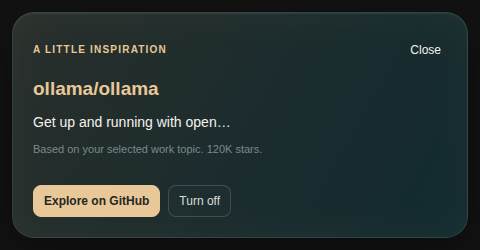

# RepoPulse 11.7.1

A personalized GitHub discovery island for Windows, macOS and Linux, focused on **50,000+ star** public projects.

## Camera-edge auto-hide / 11.6

The application now starts hidden under the top-center camera area: a **120 × 16 DIP hot zone** with just a **48 × 3 DIP visible indicator**. Hover there to reveal the animated panel; leaving uses an 80 ms debounce before collapse. Background sync and pending repository operations no longer pin the panel open. Stale keyboard focus is cleared on pointer exit. Actual editing and explicitly paused hiding remain protected.

[Behavior, changed files and regression checks](docs/AUTO-HIDE-v11.6.md).

## Current catalog / 11.5

The minimum is **50K stars**. The bundled catalog now contains **531 individually API-verified active, non-fork repositories**, including **230 additions** to the former 301-entry snapshot. The smallest verified count is **50,033**. A one-time upgrade fills the existing cache offline while retaining bookmarks, notes, history and interests.

A 3,000-entry target is supported by the 5,000-entry capacity and tested with 3,101 synthetic test-only records. Only the 531 real qualifying entries ship. Duplicate/incomplete search pages preserve the previous cache rather than falsely reporting a complete sync. **401 tests pass**. [Catalog findings, source and installer links](docs/CATALOG-v11.5.md).

[11.4 correctness audit](docs/AUDIT-v11.4.md) · [11.3 animation and geometry fixes](docs/FIX-v11.3.md).

The sections labelled with earlier versions below describe their historical behavior.

The island gently grows when the pointer enters, reveals from a compact dock on hover, and collapses after pointer leave or inactivity. Editing, keyboard focus, focus sessions and an open workspace can hold it open. Hiding means collapsing to the reachable dock; the app stays available in the system tray.

Choose Fluid, Snappy, Calm or Soft Spring motion, hover growth, timing, card appearance, accent and text scaling. The native window reserves room around transforms so hover growth stays inside its bounds. System reduced-motion preferences remain respected.


Native Electron screenshot using sample metadata. The native test temporarily disables automatic hiding and Live rotation to capture a stable desktop view; autonomous operation is exercised separately in the same test.

## Catalog recovery / 11.2

The discovery threshold is now **70,000 stars**. The old 300-project fetch cap is removed: pagination and non-overlapping star-range sharding support catalogs past GitHub's 1,000-result-per-query limit, up to a bounded 5,000-project capacity. This supports 2,000+ entries when that many qualifying repositories exist; it does not invent entries to reach a requested count.

The current GitHub query returned **301 unique eligible repositories** (100 + 100 + 100 + 1 across four pages, checked 18 November 2026 Asia/Baku). The actual count changes over time. A bundled, individually API-verified snapshot of all 301 repositories ships for immediate offline/cold startup; online sync revalidates the complete eligible set.

Seen history no longer empties a new day's feed. Previously seen candidates are reused when needed, current cards are retained if no alternative exists, and live rotation excludes already visible neighbors. No views or preference updates are recorded by automatic recovery. Truly restrictive filters show a readable empty state with a Reset feed filters action.

[Details and verified downloads](docs/FIX-v11.2.md).

## Cross-platform audit / 11.1

[Exact changed files, findings, platform limitations and validation](docs/AUDIT-v11.1.md).

The island now docks to the top-center of the active display work area. Summon with Ctrl/Cmd+Shift+P or the tray. Native macOS vibrancy and Windows corner/shadow options coexist with an opaque Linux fallback; X11 uses a native shape mask. Native Wayland placement and stacking remain compositor-controlled, with XWayland preferred when available.

Cards show one owner/repository identity, real release/commit or labelled push timestamps, official Atom links and measured star trends once sufficient history exists. All three picks are reachable in a scrollable feed. Bookmark/Skip and Open Repo belong to cards; global controls belong to the footer. Install/Downloads and Git Clone use verified package mappings or explicit OS-specific release choices; command copying never executes a shell.

Sync freshness and local rotation are separate. “Live” requires a successful catalog sync within five minutes; stale data is labelled Cached / Last synced. The old whole-window opacity slider is retired to prevent browser text bleeding through the widget.

## What changed in 11.0

- **Next picks** requests a genuinely new batch, rather than paging the same three repositories. Undo restores the preceding batch. No visit or interest update is recorded.
- **Live** runs while the pointer is over a card by default, keeps explicit pause reasons, and mixes fast and slow 140–360ms card transitions. Editing, interaction, workspaces and focus sessions remain protected.
- **Recommendation ranking** gives 200K+ stars the highest tier weight, 100K–200K a medium weight and 50K–100K a lower weight. Strong personal relevance can still win; no fixed exposure percentage is claimed.
- **Island motion and layout** use a capsule-to-panel clip morph, independent window timing, consistent line icons, aligned card content and shared spacing.
- **Idle advice** displays one small, non-focused 480×250px recommendation after at least eight minutes without mouse/keyboard activity. A 15-second poll means actual delivery can occur up to 15 seconds later. It waits while locked, hidden, opening a repository or in a workspace. Dismiss snoozes another eight minutes; Turn off disables automatic advice.
- **Optional Windows context** derives topic weights from the foreground window title locally. Enable it under Settings → After 8 minutes away. Raw titles are discarded, not stored. No screenshots, OCR, cookies or cloud analysis are used. Without context, including on macOS/Linux, the chosen work topic is used.

[220-idea roadmap with phases and acceptance criteria](docs/ROADMAP-220.md). These are planned items, separately tracked from the changes above. [11.0 validation and packages](docs/CHANGES-v11.md).



The compact suggestion uses deterministic fixture metadata in this native preview.

## Hover stability / 10.1.2 (inherited)

Native pointer/window membership now controls hover so resizing or scaling the island cannot repeatedly expand and collapse it. A fixed anchor preserves dock position near display edges, and stale window acknowledgements cannot override the latest intent. The regression uses an actual desktop pointer and checks stationary hover plus rapid exit/re-entry. See [verified downloads and upgrade instructions](docs/CHANGES-v10.1.2.md).

Quit the old process from the tray before starting the update; closing its window only hides it. Settings must show **11.6.0**.

## Compact actions / 10.1.1

Click the repository name in the small island to open its GitHub page. A short one-line explanation appears below it. The link stays stable on hover, supports keyboard activation and does not also expand the panel. Click empty header space to expand. See [the tested corrections and current installers](docs/CHANGES-v10.1.1.md).

## Live discovery / 10.1.0

Unseen repositories now replace one visible row automatically every 3–10 seconds of active time. Use Live to pause/resume, or tune the interval and choose from 22 transition styles in Settings. Editing, keyboard navigation, workspaces and focus sessions are protected. Hover pause is optional and defaults off in 11.0. Automatic display does not count as a visit or train your interests. After unseen candidates are exhausted, Live can revisit eligible projects after a 30-minute cooldown. Next picks can revisit sooner, with a clear message.

Rotation uses the cached eligible catalog. Install checks releases on demand, so every new card does not generate a background release request. See [the full change list and installers](docs/CHANGES-v10.1.md).

## Compact update 10.0.1

960px discovery panel, 360px compact dock, zero hover/leave delay and approximately 69ms default transitions. Existing appearance settings migrate once. See [changes and downloads](docs/CHANGES-v10.0.1.md).

## Version 10

A redesigned discovery view pairs larger repository titles and descriptions with warm sand accents, deep teal panels and clearer browser actions. Library, notes, collections, comparison and preferences now open in a dedicated sidebar workspace with one content scroller.

Hover and automatic hiding keep their deadlines through metadata refreshes. Notes update from imported annotations until you start editing; active drafts remain protected. Window geometry handles invalid saved positions and small displays, and startup restores the appropriate monitor.


See [v10 changes and verified downloads](docs/CHANGES-v10.md). The earlier [Ultimate inventory](docs/ULTIMATE-v0.5.md) remains available for the inherited workspace features.

## Personal workspace

- Cached project library with multi-term search, personal-note search, negative terms and owner:, lang:, tag:, is: operators.
- Personal notes, tags, ratings, pins, read status and a reading queue with priorities.
- Bulk save, queue, pin and read actions.
- Named color-coded collections, validated workspace import/merge, JSON and CSV export.
- Compare up to three projects; inspect shared topics and cached project metadata.
- Local visit statistics, a seven-day histogram, language distribution and topics.
- Ctrl/Cmd+K command palette, keyboard command navigation and a local focus timer.

The [implemented inventory](docs/ULTIMATE-v0.5.md) lists 156 controls, workflows and corrections. It distinguishes shipped functionality from future ideas.

## Browser actions

**Learn More** opens the selected repository in the default browser. **Install** checks public releases and opens Releases when available. **Guide** opens the README. Auxiliary GitHub links do not replace the daily repository row. Clone commands are copied only.

Opening a discovery replaces that same row with an unseen eligible project. Undo restores the last selection. The eligible catalog remains non-fork, non-archived and at least 50K stars. Exhaustion shows an empty state.

## Run and build

Requires Node.js 24+.

```sh
npm install
npm start
npm run preview
npm test
npm run check
npm run dist
```

[GitHub Actions](https://github.com/rvnsre/RepoPulse/actions) tests the code and packages Windows EXE, macOS arm64 DMG/ZIP and Linux x64 AppImage/DEB/RPM. Successful run artifacts are downloadable. Packages are unsigned previews; publishing a version label does not itself attach installer assets.

The loopback-only browser preview uses deterministic sample data and simulated external actions. It does not read personal desktop data or open external programs.

The real Electron native check covers readable text, stable row DOM, browser destinations, replacement/undo, 150% text, notes/tags, library focus retention, bulk read, collections, comparison, Insights, command palette, focus mode, auto-hide, hover reveal/growth and narrow display behavior.

## Data and privacy

Personal notes, interest weights, history, collections and preferences stay in per-user storage. Workspace imports merge validated records; exports are chosen explicitly. Search and statistics use local data. Public GitHub requests are still subject to rate limits.

The optional browser extension processes recent history only after choosing Analyze and exports topic weights for manual desktop import. There is no cookie access, secret extraction, background browser tracking, cloud AI or automatic browser synchronization.

## Shortcuts

| Shortcut | Action |
|---|---|
| Ctrl/Cmd+Shift+Space | Toggle island |
| Ctrl/Cmd+K | Command palette |
| Ctrl/Cmd plus / minus / zero | Text size |
| J / K | Select row |
| S / Q / P | Save / queue / pin selected project |
| D / I | Details / public releases |
| F | Start or stop focus session |
| N / U / R | New picks / undo / refresh |
| / | Search saved projects |
| ? | Command help |
| Escape | Close workspace or collapse |

Letter shortcuts can be disabled in Settings.

Copyright 2026 Ravan Sariyev. Distribution license is not yet selected. Signing, automatic updates, browser-store publication and native OS acceptance testing remain release work.


## Final release audit — v11.7.1

The final release includes the camera-edge auto-hide and discovery fixes from v11.6, plus atomic full-data reset, removal of unsaved private drafts and focus holds after reset, locked dependency installation, explicit OS/CPU installer names, and a gated tag-only upload of actual installers and SHA-256 checksums. See [the final audit](docs/FINAL-v11.7.1.md).

Download from [Releases](https://github.com/rvnsre/RepoPulse/releases/latest). Quit any old running version from the tray before starting the new executable.
