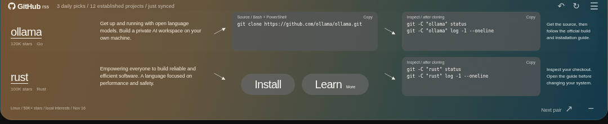

# RepoPulse 0.3

A personalized GitHub discovery island for Windows, macOS and Linux, focused on established **50,000+ star** projects.

The warm brown-to-teal reference layout now uses readable typography: 24px repository names, 14px descriptions and 13px command text, with 100–150% text scaling. Choose one to three rows, panel width, command visibility and motion preferences.



Preview above is from 0.2 with illustrative test metadata; 0.3 preview will be recorded by the native UI check.

**Learn More** opens that repository directly in your default browser. **Install** checks public GitHub releases and opens its Releases page when available. Projects without releases show **No release**; **Guide** in Details opens the README. Commands are copied only.

Opening a project replaces its exact row with an unseen eligible recommendation. The neighboring row stays in place. Undo restores the previous selection. Save no longer rebuilds rows, hover does not change the action target, and superseded animations are cancelled. Text zoom, responsive columns and content-aware native sizing keep the panel readable.

See [56 implemented changes](docs/CHANGES-v0.3.md), the [feature inventory](docs/FEATURES.md), [privacy details](docs/PRIVACY.md) and [release checklist](docs/RELEASE.md).

## Run and build

Requires Node.js 24+.

```sh
npm install
npm start
npm test
npm run check
npm run dist
```

[GitHub Actions](https://github.com/rvnsre/RepoPulse/actions) tests the code and packages Windows EXE, macOS DMG/ZIP, Linux AppImage/DEB/RPM. Download artifacts from a successful run. These preview builds are unsigned; packaging does not replace OS installation and real-device display testing.

The native Linux Electron smoke test verifies browser destinations without launching an external browser, independent row replacement, undo, stable row DOM, readable font sizes, large-text layout and rapid mode changes. It also captures native screenshots.

## Discover and organize

Saved collections, multi-term search, language filters, sorting, history export and individual history removal are local. Minimum stars cannot go below 50K. Owner blocking, hidden projects and snoozes can be restored individually. Projects remain non-archived and non-forks. Manual interests and reaction learning personalize future picks; learning can be paused.

The initial daily queue contains up to three projects. Opening projects can reveal more that day. A finite catalog cannot supply unlimited unseen projects; exhaustion shows an empty state. Undo and explicit restoration intentionally allow earlier projects to return.

## Browser interests

Load `extension/` unpacked in Edge, Chrome or Brave. Choose Analyze to request optional history permission, process recent pages locally and export topic weights. Import that JSON under Interests in the app. There is no cookie access, secret extraction, background tracking, remote AI service or automatic browser synchronization.

## Keyboard

| Shortcut | Action |
|---|---|
| Ctrl/Cmd + Shift + Space | Toggle island |
| Ctrl/Cmd + plus / minus / zero | Text scale |
| J / K | Select row |
| Enter | Open focused repository |
| S | Save selected project |
| U | Undo replacement |
| R | Refresh catalog |
| N | Next rows |
| I | Open releases when available |
| / | Search saved projects |
| Escape | Close workspace or collapse |

Shortcuts can be disabled in Settings.

## Data

Personal weights, history, preferences and collections stay in per-user local storage. Public metadata is cached for six hours, release availability for 15 minutes. No account or API key is required. GitHub receives normal network metadata for public requests. Rate limits and timeouts show recoverable messages.

Copyright 2026 Ravan Sariyev. Distribution license is not yet selected. Code signing, automatic updates and browser-store publication remain future work.
