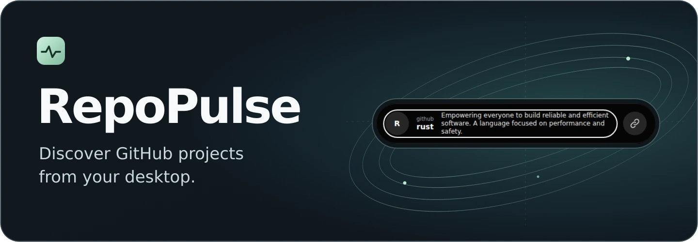
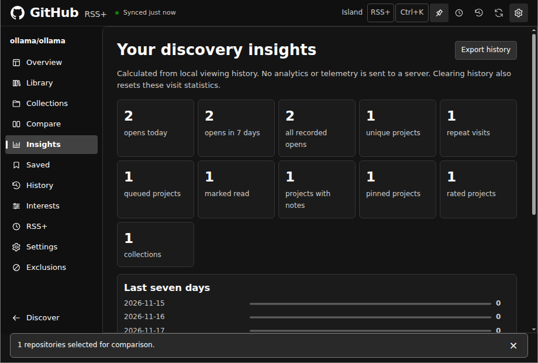

<h1 align="center">RepoPulse</h1>

<p align="center">
  
</p>

<p align="center">
  <strong>Discover GitHub projects from a compact desktop island.</strong><br>
  Browse a curated catalog, save useful finds, and open public releases from one workspace.
</p>

<p align="center">
  <a href="https://github.com/rvnsre/RepoPulse/releases/latest"><strong>Download RepoPulse</strong></a>
  · <a href="#what-you-can-do">Explore features</a>
  · <a href="#build-from-source">Build from source</a>
</p>

## Download v13.0.0

| Platform | Downloads |
| --- | --- |
| Windows x64 | [Installer](https://github.com/rvnsre/RepoPulse/releases/download/v13.0.0/RepoPulse-13.0.0-Windows-x64-Setup.exe) · [Portable](https://github.com/rvnsre/RepoPulse/releases/download/v13.0.0/RepoPulse-13.0.0-Windows-x64-Portable.exe) |
| macOS Apple silicon | [DMG](https://github.com/rvnsre/RepoPulse/releases/download/v13.0.0/RepoPulse-13.0.0-macOS-arm64.dmg) · [ZIP](https://github.com/rvnsre/RepoPulse/releases/download/v13.0.0/RepoPulse-13.0.0-macOS-arm64.zip) |
| macOS Intel x64 | [DMG](https://github.com/rvnsre/RepoPulse/releases/download/v13.0.0/RepoPulse-13.0.0-macOS-x64.dmg) · [ZIP](https://github.com/rvnsre/RepoPulse/releases/download/v13.0.0/RepoPulse-13.0.0-macOS-x64.zip) |
| Linux x64 | [AppImage](https://github.com/rvnsre/RepoPulse/releases/download/v13.0.0/RepoPulse-13.0.0-Linux-x86_64.AppImage) · [DEB](https://github.com/rvnsre/RepoPulse/releases/download/v13.0.0/RepoPulse-13.0.0-Linux-amd64.deb) · [RPM](https://github.com/rvnsre/RepoPulse/releases/download/v13.0.0/RepoPulse-13.0.0-Linux-x86_64.rpm) |

The installers are unsigned. [SHA-256 checksums](https://github.com/rvnsre/RepoPulse/releases/download/v13.0.0/SHA256SUMS.txt) · [Release notes](https://github.com/rvnsre/RepoPulse/releases/tag/v13.0.0)

v13.0.0 is an existing release. The subsequent master-specification work is being reviewed in separate pull requests; these downloads do not include those changes or establish that the new accessibility, security and installed-package gates have passed.

## What you can do

| Task | How RepoPulse helps |
| --- | --- |
| Find projects worth exploring | Browse cached public repositories. The source catalog accepts 5K+ stars and the v13 discovery filter defaults to 20K+. Narrow by interests and star count, or tap **Next** to see another set. Counts reflect actual matching records, not catalog capacity. |
| Keep discovery within reach | The island docks to the top of the display. Show it from the system tray or with **Ctrl/Cmd + Shift + P**. |
| Organize what you find | Bookmark and queue projects, add private notes and tags, group projects into collections, and compare them side by side. |
| Go from discovery to download | Open the original GitHub repository, check its public release assets, or copy a clone command to run yourself. |

<details>
<summary>See the desktop workspace</summary>
<br>

</details>

## Privacy and offline use

The bundled catalog can be browsed offline. Internet access is used for catalog refresh, current GitHub metadata, and release checks. Personal notes, history, collections, and interest settings are kept in local app storage. The optional browser companion analyzes recent history only when you choose to run it and exports topic weights for manual import. [Privacy and data flow](docs/PRIVACY.md)

## Build from source

Use Node.js 24 and npm from the repository root.

```bash
npm ci
npm start
npm test
npm run check
```

Run `npm run dist` to package the app. [Build workflow](.github/workflows/build.yml) · [Report an issue](https://github.com/rvnsre/RepoPulse/issues/new)

Copyright © 2026 Ravan Sariyev.
