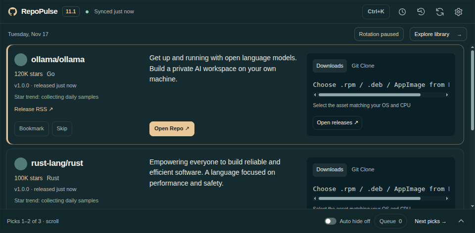

# RepoPulse 11.1 — cross-platform audit

Baseline: GitHub main `37015fbba4b69948a4360a0d5b6c00ef639fd046` (11.0). The supplied local folder was an older 10.0 export, so implementation uses a separate folder containing current source.

## Structure and exact changed files

Electron 40, CommonJS backend, context-isolated preload and vanilla JavaScript/CSS. There is no Tauri configuration. electron-builder still produces Windows NSIS/portable EXE, macOS DMG/ZIP and Linux RPM/DEB/AppImage. No new runtime dependency or workflow permission expansion.

| Files | Responsibility |
|---|---|
| `app/main.cjs` | Active-display docking/summon, platform options, display/DPI changes, native shape/shadow, tray/hotkey recovery, fresh catalog polling, activity IPC, star observations, Skip |
| `app/preload.cjs` | Narrow activity bridge |
| `app/index.html` | Header/footer hierarchy, trusted avatar CSP, accessible controls |
| `app/renderer.js` | Three reachable picks, identities, metadata hydration, command selector, aligned actions, Undo toast, freshness |
| `app/ultimate.js` | Platform shortcuts, History/Settings icons, Auto hide switch, separate rotation status, Wayland fallback |
| `app/styles.css` | Dock framing, compositor fallback, card grid, descriptions, scrolling, global footer |
| `app/island-motion.js`, `app/morph.js` | Leave debounce and platform-specific surface insets |
| `src/layout.cjs`, `src/discovery.cjs` | 64-DIP dock, work-area anchoring, one-time debounce migration |
| `src/engine.cjs` | Canonical avatar normalization |
| `src/github.cjs` | Conditional ETag requests |
| `src/navigation.cjs` | Official release Atom route |
| `scripts/preview.cjs` | Isolated fixture bridge for new metadata and UI |
| `scripts/smoke.cjs` | Native input, scrolling, actions, copying, freshness and baseline regressions |
| `test/compact.test.cjs`, `test/dock-regressions.test.cjs`, `test/workspace.test.cjs` | Updated intentional dock/debounce expectations |
| `package.json`, `README.md` | 11.1.0, current behavior and verification |

New modules:

- `src/window-policy.cjs`: pure platform capability/options policy, active display and native X11 shape.
- `src/activity.cjs`: bounded/coalesced GitHub activity fetcher and measured star observations.
- `src/install.cjs`: verified package mappings and npm manifest provenance checks.
- `app/feed-ui.js`: shared sync/age/activity/shortcut presentation.
- `test/audit.test.cjs`: platform, geometry, freshness, metadata, install and star-history tests.
- `docs/AUDIT-v11.1.md`: this report; final native screenshots are listed below when available.

## Findings and implementation

| Finding | Result |
|---|---|
| Saved arbitrary overlay geometry | Summon docks to the cursor's active display work-area top-center. Display removal and DPI changes recompute integer DIP bounds; no manual scale-factor multiplication. |
| macOS trails/menu collisions | Native sidebar vibrancy and active visual effect, floating level, bottom-rounded content, work area below the menu bar and shadow invalidation. A custom hardware-notch surface is not claimed. |
| Windows fuzzy borders/background text | Rounded-corner and shadow options, crisp opaque content inside the frameless transparent shell, bounded CSS shadow and integer DIP placement. Whole-window opacity stays 1; the old opacity slider is retired. |
| Linux black alpha corners | Opaque frameless default. X11 native shape masks bottom corners without alpha-compositor dependence. `REPOPULSE_TRANSPARENT=1` enables optional X11 transparency. |
| Native Wayland restrictions | Prefer XWayland when DISPLAY is available. Otherwise expose compositor placement, opaque fallback, DOM pointer handling and portal shortcut capability. Arbitrary top-center placement and stacking cannot be guaranteed by Electron under every compositor. |
| Hidden app without recovery | Tray summon/collapse/sync/quit; Ctrl/Cmd+Shift+P and legacy Shift+Space. If both tray and shortcut are unavailable, close minimizes to a reachable taskbar entry. |
| Hover flicker | Preserve request ordering and native pointer tracking, with a 140ms default leave debounce. Explicit zero delay remains supported. |
| Stale data labelled Live | Revalidate the catalog approximately every four minutes. Live is used only below five minutes since successful sync; otherwise Cached and exact Last synced minutes, with an appropriate dot. Local rotation is independent of network freshness. |
| Duplicate counts/hidden third pick | Catalog count belongs to Library. All three picks exist in a scrollable feed with a visible scrollbar and Picks x–y of 3 indicator. Panel height changes viewport capacity, not the available picks. |
| No RSS context | Real release tag/publication date or commit timestamp; catalog push date is explicitly Last push. Each card links to GitHub's release Atom feed. Unavailable metadata is not fabricated. |
| Unsupported daily star claims | Keep up to 73 hourly observations per current catalog repository. Compare approximately 24-hour observations and label their measured interval. Show collecting samples until valid history exists. |
| Repeated owner subtitles | One canonical owner/repo identity with owner avatar and graceful image fallback. Fixture screenshots use generated placeholders. |
| Competing Details/Learn/Install actions | Open Repo on the card; advanced selected-project work stays in the workspace. Install/copy lives in the command selector. Footer is global-only. With command boxes hidden, one compact install/download action remains on the card. |
| Save/Like ambiguity | Bookmark and reversible Skip. Undo is an explicit toast action rather than an unexplained header arrow. Skip records no browser visit or preference. |
| Ragged buttons and early truncation | Stretch both card columns, align action rows at their bottoms, allow three description lines and retain large-text/narrow-window scrolling. |
| Bash/PowerShell label and broken URLs | Install/Downloads and Git Clone tabs, keyboard navigation, nowrap horizontal code scrolling and full backend command copying. Commands are never executed. |
| Guessed install IDs | Axios uses npm; Clash Verge Rev uses verified exact WinGet on Windows and Homebrew cask on macOS, with OS-labelled releases on Linux. Unknown registries fall back to downloads, not guessed dnf names. |
| Other JavaScript libraries | Offer npm only after validating the root package name, public status and matching repository provenance. Mismatched/private manifests fall back to source/downloads. |
| Ambiguous header/footer | OS command label, History/Force sync/Settings tooltips, Auto hide switch, Queue badge, Next → and collapse chevron. External links use ↗; internal Library uses →. Decorative Live line removed. |

## Networking and install provenance

Activity requests are coalesced, cached for 15 minutes, concurrency-limited and budgeted to 36 REST calls per rolling hour. Unmapped JS/TS manifest verification costs an additional request. Rate limits cause backoff. Budget exhaustion falls back to honest catalog push dates. Explicit user release checks remain on demand. Catalog requests use ETags and GitHub's separate search quota.

Package mappings checked on 17 November 2026:

- https://github.com/axios/axios/blob/v1.x/package.json
- https://github.com/microsoft/winget-pkgs/blob/master/manifests/c/ClashVergeRev/ClashVergeRev/2.5.9/ClashVergeRev.ClashVergeRev.yaml
- https://formulae.brew.sh/cask/clash-verge-rev

Electron constraints: https://www.electronjs.org/docs/latest/api/browser-window and https://www.electronjs.org/docs/latest/tutorial/custom-window-styles . CSS blur cannot blur another application; macOS uses native vibrancy. Native Wayland does not grant every app universal docking/stacking privileges.

## Validation and remaining OS acceptance

220 Node tests plus syntax/JSON/taxonomy checks pass locally, including 28 new audit regressions. Local Chromium cannot start because this execution environment rejects its singleton socket; native Electron CI is used for visual and desktop-pointer checks. Final build evidence and download links follow below.

| Environment | Physical/compositor acceptance |
|---|---|
| Windows 11 at 100/125/150% | Move between monitors, summon and repeatedly expand/collapse; check crisp edges and correct center. |
| macOS notch and external display | Menu bar shown/hidden, active-display summon, blur, corners and no animation trails. |
| X11 without compositor | Native masked opaque corners, no black alpha box, tray/hotkey access, stable hover. |
| XWayland | Active-display summon, stacking and native pointer tracking. |
| Native Wayland | Stated compositor placement, opaque fallback, available portal/hotkey or taskbar recovery. |
| Offline/rate limit | Cached status, amber/error dot and honest Last push fallback; never false Live. |

Platform configuration tests and successful package compilation do not substitute for these device checks. Quit the old tray process before opening the update and verify 11.1.0 in Settings. Packages remain unsigned preview builds in Actions artifact ZIPs; they are not automatically published GitHub Release assets.

## Final build evidence

Source: [692990b](https://github.com/rvnsre/RepoPulse/commit/692990b3ecd8810ed55bd27c375167d8d888e98e). [Successful verification and packaging run](https://github.com/rvnsre/RepoPulse/actions/runs/44126425948). All five jobs passed, including 220 tests and syntax/JSON/taxonomy checks.

The real Electron/X11 check passes: native pointer/resize stability and interrupted re-entry, all three picks reachable by scrolling, no duplicated footer actions, matching action baselines, npm and complete Git Clone clipboard contents, keyboard command-tab navigation, 150% text/narrow layout, accurate 78-minute stale header/Cached status/dot, browser destinations, replacement/undo, prior workspace/draft flows and compact idle advice. Metadata hydration is scoped to cards so the compact ticker sharing a repo ID cannot consume the update.

| Platform | Contents of artifact ZIP | Download |
|---|---|---|
| Windows x64 | NSIS installer and portable EXE | [RepoPulse-Windows](https://github.com/rvnsre/RepoPulse/actions/runs/44126425948/artifacts/14347981263) |
| Linux x64 | RPM, DEB and AppImage | [RepoPulse-Linux](https://github.com/rvnsre/RepoPulse/actions/runs/44126425948/artifacts/14349365157) |
| macOS arm64 | DMG and app ZIP | [RepoPulse-macOS](https://github.com/rvnsre/RepoPulse/actions/runs/44126425948/artifacts/14349046029) |

Actions installer artifacts expire after 30 days and normally require GitHub sign-in. All packages use the same source commit. macOS and Windows packaging passes; this does not claim physical device visual acceptance.

Native Electron screenshot with deterministic fixture repositories, generated placeholder avatars and simulated release metadata. Live and auto-hide are temporarily paused for capture and exercised separately in the same native test. The screenshot is not a claim about these projects' current public release tags.
