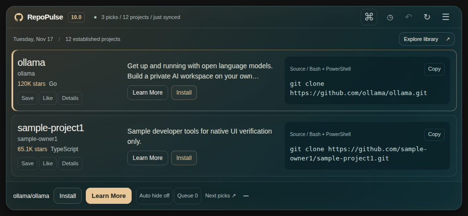

# RepoPulse 10.0.1 — compact and immediate

The discovery panel now defaults to 960 CSS pixels wide. The large hero title is removed, header/footer spacing is reduced, repository rows are denser, and secondary inspection commands stay in Details. Description text remains 14px and command text 13px at 100% text scale.

Hover reveal and pointer-leave delays default to zero. The default Snappy transition takes approximately 69ms, and closing is capped at 80ms. Reduced-motion and protected editing/workspace behavior remain supported. Immediate, 80ms and 160ms pointer-leave settings are available alongside longer delays.

The compact dock is 360 × 80 CSS pixels. Both modes remain bounded by the monitor work area. The first launch after upgrading migrates existing appearance/motion settings to the compact defaults once; personal data and text scale are preserved. Later manual timing and width choices persist.

108 unit tests and syntax checks passed. The real Electron suite additionally verifies the default two-row panel is no wider than 960px and under 500px high, readable text, overflow, direct browser links, row replacement/undo, workspace, 150% text, hover growth and narrow windows.

[Build and platform downloads](https://github.com/rvnsre/RepoPulse/actions/runs/44041255947). Installer packages are unsigned GitHub Actions artifact ZIP downloads, not release assets. Extract the ZIP and use the installer in dist/. macOS targets arm64; Windows and Linux target x64.

All platform packaging jobs passed. Downloads expire on 17 December 2026; GitHub sign-in may be required.

| Platform | Installer ZIP |
|---|---|
| Windows x64 EXE | [Download](https://github.com/rvnsre/RepoPulse/actions/runs/44041255947/artifacts/14309840974) |
| Linux x64 AppImage / DEB / RPM | [Download](https://github.com/rvnsre/RepoPulse/actions/runs/44041255947/artifacts/14309457908) |
| macOS arm64 DMG / ZIP | [Download](https://github.com/rvnsre/RepoPulse/actions/runs/44041255947/artifacts/14310010752) |

Screenshot from real Electron with deterministic sample metadata. Auto-hide is disabled temporarily during screenshot capture.
