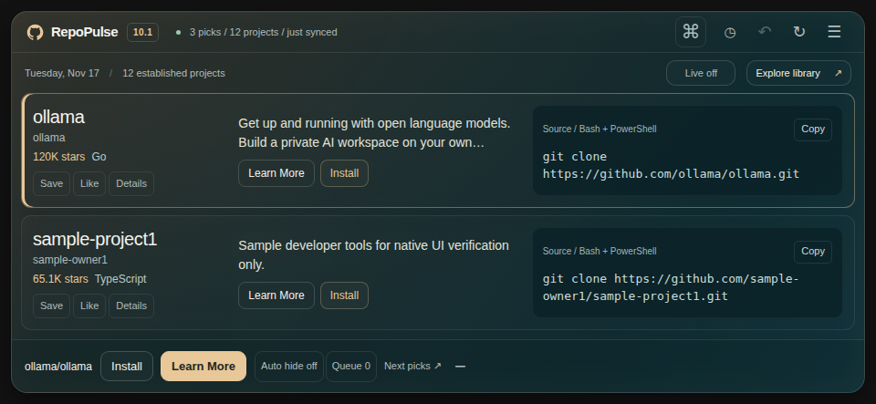

# RepoPulse 10.1.0 — Live discovery

The compact 960px island now replaces one visible repository automatically after a randomized 3–10 seconds of active time. Timings can be fixed (for example 5–5 seconds), and Live can be paused from the header. Rotation is enabled by default for existing and new installations.

## Safe autonomous behavior

- Uses the eligible cached catalog and no-repeat memory. No browser is opened automatically.
- Keeps 50K+ star, non-fork, non-archived eligibility and the user's filters/exclusions.
- Does not add viewing-history entries, mark projects read, or train personal interests merely because a card appeared.
- Pauses on a hovered card or keyboard-focused card by default, and always while editing, in a workspace or focus session, during another operation, or while the page is hidden.
- Undo holds rotation for ten seconds. Hover and keyboard pause can be configured separately.
- Retains the current cards when no unseen eligible projects remain and shows “caught up”. A changed catalog or filter configuration can resume it; it does not silently recycle old projects.
- Single timer and in-flight request protection; no queued catch-up burst after a hidden or paused interval.
- Main process enforces a three-second minimum between successful automatic replacements and rejects stale rows/day requests.
- A compact countdown, pause reason and progress indicator share the existing header.

## 22 dynamic transition styles

| Style | Name |
|---|---|
| fade | Soft fade |
| rise | Rise |
| sink | Sink |
| left | Slide left |
| right | Slide right |
| zoom-in | Zoom in |
| zoom-out | Zoom out |
| blur | Focus in |
| blur-rise | Focus rise |
| flip-x | Flip horizontal |
| flip-y | Flip vertical |
| skew-left | Skew left |
| skew-right | Skew right |
| tilt-left | Tilt left |
| tilt-right | Tilt right |
| wipe-left | Reveal from left |
| wipe-right | Reveal from right |
| wipe-up | Reveal upward |
| wipe-down | Reveal downward |
| diagonal | Diagonal glide |
| soft-spring | Soft spring |
| focus-zoom | Focus zoom |

Automatic mode alternates six subtle styles; any of the 22 styles can be selected in Settings. Exit/entry transitions share a scene, arriving cards can pulse their outline, and row staggering is retained. Existing fast timing and reduced-motion controls remain respected. Hidden/collapsed feed rows skip animation work.

## Reliability corrections

- Empty-feed cleanup cancels obsolete row animations and invalidates pending replacements.
- Completed replacements request a layout fit so a changed card height is accounted for.
- Late animation completions cannot update superseded slots.
- Cosmetic renders no longer reset the live deadline; paused active time is retained.
- A mouse click does not latch keyboard pause, and an inactive app cannot retain keyboard rotation protection.
- Settings dropdown values are normalized as numbers; min/max endpoints are ordered and bounded to 3–10 seconds.
- Countdown progress starts from its actual selected period.
- Background release prefetch is removed. Install still verifies public releases on demand; cycling cached cards does not trigger a GitHub request per card.
- Development fixture serves the live module/API and obtains the version from package metadata.

## Verification and packages

Code commit: `8bab84d9446ae545beae14793933bbe0b3e8330d`. 126 unit tests, syntax/JSON checks and extension taxonomy verification passed. The real Linux Electron suite additionally passed automatic replacement without a click, live pause, unchanged history/interest weights and all 22 scenes through the native animation engine, alongside the existing readability, browser navigation, workspace, auto-hide and narrow-layout checks.

All five jobs passed in [build 44045647880](https://github.com/rvnsre/RepoPulse/actions/runs/44045647880): verify, browser companion, Windows, macOS and Linux packaging. These are unsigned preview packages. Installed-device acceptance, signing and automatic application updates remain future release work.

| Platform | Package | Download |
|---|---|---|
| Windows x64 | Installer and portable EXE | [Windows ZIP](https://github.com/rvnsre/RepoPulse/actions/runs/44045647880/artifacts/14311846054) |
| Linux x64 | AppImage / DEB / RPM | [Linux ZIP](https://github.com/rvnsre/RepoPulse/actions/runs/44045647880/artifacts/14310788925) |
| macOS arm64 | DMG / ZIP | [macOS ZIP](https://github.com/rvnsre/RepoPulse/actions/runs/44045647880/artifacts/14311132338) |
| Browser companion | Extension source | [Companion ZIP](https://github.com/rvnsre/RepoPulse/actions/runs/44045647880/artifacts/14311466167) |

Downloads are GitHub Actions artifact ZIPs, not attached release assets. GitHub sign-in may be required. Extract the archive and select the installer in dist/. Artifacts expire on 17 December 2026.

Native Electron screenshot with deterministic sample metadata. Auto-hide and Live are temporarily disabled during the stable preview capture; autonomous operation is separately exercised in the same native test.

