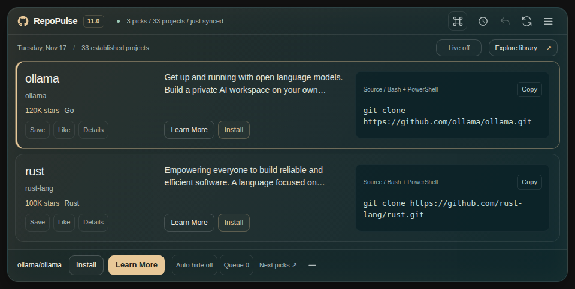
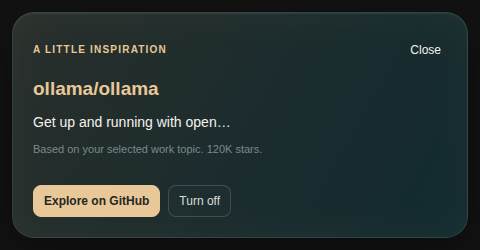

# RepoPulse 11.0.0

## Scope

This update fixes the Next picks paging bug and the default Live-hover pause, adds tier-aware ranking, mixed card speed, window shape morphing and a compact eight-minute idle recommendation. Cards use a shared 12/16px spacing rhythm, consistent SVG toolbar icons and aligned descriptions/actions.

Next uses unseen eligible candidates first and can explicitly revisit earlier candidates after exhaustion. Live only revisits after a 30-minute per-project cooldown; it never selects a currently displayed neighbor as the replacement. Automatic display and Next do not count as browser visits. Undo preserves no-repeat memory.

## Work advice and privacy

The main process reads OS idle time. At 480 seconds or later, with up to 15 seconds polling delay, it can show one small recommendation without focus stealing. Lock state, hidden window, active workspace and repository-opening operations defer it. The idle period is rearmed after returning to activity. Dismiss snoozes for eight minutes; Turn off persists the disabled preference.

The optional Windows adapter derives a topic from the foreground window title with a hidden, time-bounded local process. Raw titles are never persisted or sent to a remote service. Sensitive-title patterns are omitted. This is title/category analysis, not full screen vision. Other platforms and unsupported contexts use the manually selected work topic. Preview recommendation in Settings tests the same card without waiting eight minutes.

## Validation

192 Node tests and syntax/JSON/taxonomy validation pass. This includes 23 new regressions for Next batches, exhausted pools, cooldowns, live migration, tier ranking, adaptive speeds, reduced motion, clipped geometry, idle boundaries, lock/disable/snooze, title omission and collector bounds. The existing personal-interest test caught an excessive popularity weight; the final ranking preserves strong personal matches.

Native Linux verification passes, including real hover/resize input, autonomous 3-second rotation, 22 animation scenes, Next batch through IPC, compact insight rendering and dismissal. Native tests use actual desktop pointer movement, IPC and the animation engine. Idle threshold tests use controlled times; native advice uses the Preview IPC rather than waiting eight minutes. Windows/macOS builds do not imply native acceptance testing on the user's device.

## Upgrade

Quit RepoPulse from the system tray before opening the new binary. Closing the window hides the old process, and singleton behavior can otherwise reopen that previous version. Verify version 11.0.0 in Settings.

Packages are unsigned preview builds. GitHub Actions artifact ZIPs contain the installers; these are distinct from published GitHub Release assets. See the final verified run linked below.

## Forward plan

[220 planned improvements](ROADMAP-220.md), grouped into 22 areas with priorities, effort estimates, dependencies and acceptance gates. They are not advertised as 220 shipped features.

## Build evidence

Windows and Linux packages, native Linux checks and the 192-test verification pass. The final macOS job was still waiting for a hosted runner when this document was written; its live status is linked below. The preceding 11.0 source build produced a DMG successfully, but that binary predates the final toast correction and is not presented as the final package here.

Source: [f15671e](https://github.com/rvnsre/RepoPulse/commit/f15671efc6c5926a4f67b2c0101c070e207ecdd8). [Verification and package run](https://github.com/rvnsre/RepoPulse/actions/runs/44113764434).

| Platform | Files in artifact ZIP | Download |
|---|---|---|
| Windows x64 | NSIS installer EXE, portable EXE | [RepoPulse-Windows](https://github.com/rvnsre/RepoPulse/actions/runs/44113764434/artifacts/14342211714) |
| macOS arm64 | DMG and app ZIP | [Live macOS build / artifacts appear when completed](https://github.com/rvnsre/RepoPulse/actions/runs/44113764434) |
| Linux x64 | AppImage, DEB and RPM | [RepoPulse-Linux](https://github.com/rvnsre/RepoPulse/actions/runs/44113764434/artifacts/14342377000) |

GitHub sign-in is normally required to download Actions artifacts. Installer artifact retention is 30 days; these links are not permanent Release assets. Build results describe compilation/packaging. Native behavioral testing in this run uses Linux; a Windows active-window collector also has mocked execution tests, but no claim of live Windows desktop acceptance is made.

